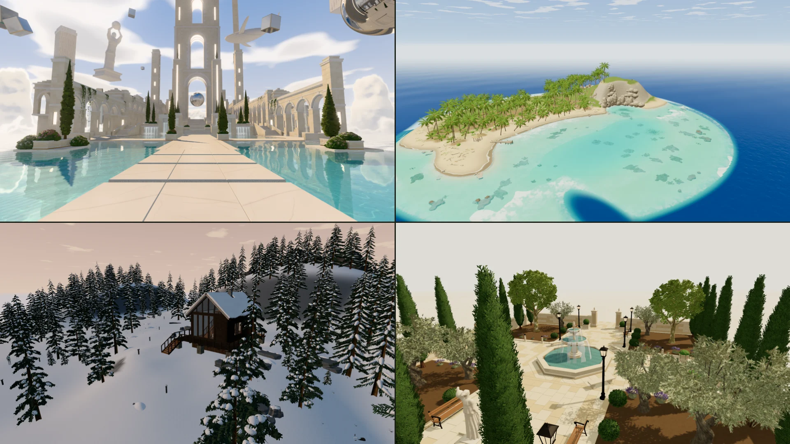
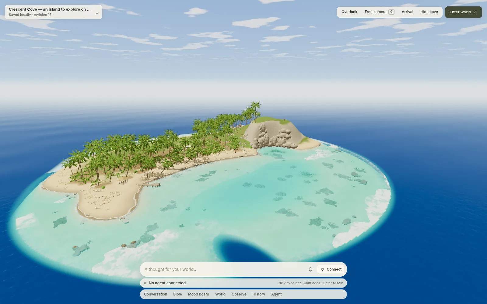
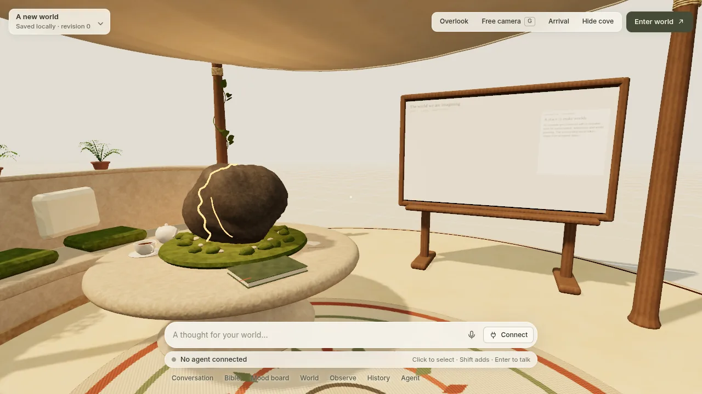

# Holodeck

A local browser workspace for creating worlds with your coding agent, powered by Kiln.

Start in a cozy cove inside the grid construct. Connect your local agent, collect references on a mood board, write a world bible, and build the world around you. Hide the cove to explore, then return to editing when you want to change something.

Holodeck is an early, actively changing prototype. It is available from source; there is no npm release.



Walk the example worlds in your browser at [holodeck.kilnstudio.tools](https://holodeck.kilnstudio.tools/): Meridian Sanctuary, Crescent Cove, the Quiet Courtyard, Tidemark Island, Winter Mountainside Cabin and the Cove.





## Start locally

You need Git, Node.js and npm. `npm ci` is the install step; launch does not download dependencies. Agent authoring uses an installed Codex CLI signed in with ChatGPT, the Cursor CLI, or your own installed Claude Code CLI signed in with your Claude subscription.

```sh
git clone https://github.com/instruktlabs/holodeck.git
cd holodeck
npm ci
node bin/holodeck.mjs launch
```

With no directory, launch uses `cove` inside `holodeck-worlds` next to your current directory, outside this checkout. A new folder receives the construct cove. An existing Holodeck world is reopened, and a folder that is not a world is left unchanged. The command starts the local server and opens `prototype.html`.

To choose the folder yourself: `node bin/holodeck.mjs launch ../my-worlds/first-world`. Then choose **Connect** in the dock at the bottom of the screen, pick **Codex**, **Cursor** or **Claude Code**, connect, select a model or Cursor mode, and describe what to build. For Claude Code, sign in first by running `claude` in a terminal; Holodeck checks `claude auth status` and never handles your Claude credentials. Connect also configures Kiln tools in that world's workspace.

The world-name menu lets you create and switch worlds or start from an editable example: **Meridian Sanctuary**, **Crescent Cove**, **Tidemark Island**, **Winter Mountainside Cabin** or the **Quiet Courtyard**. Each world has its own scene, references and revision history. Your worlds live outside the source checkout, in a parent folder you choose.

See [getting started](docs/getting-started.md) for the full flow. The current checkout has been tested with Node 24.20.0 and npm 11.19.0.

## What you can do

- Build through a local Codex, Cursor or Claude Code conversation, with model selection, approvals and cancellation. Allow an exact command, or all Kiln workspace tools, once for the session.
- Edit a shared world bible and mood board with images, notes, file references and imported reference packs.
- See a proposal's placements as ghosts in the world, review its differences, then apply it; hot-load validated Kiln assets.
- Shape terrain with stamps or a sampled heightmap pinned by hash, dress it with textured material layers, fill groves and undergrowth with seeded scatter, and add optional surf and a cloudy sky. Objects under water take the depth tint automatically, and collider tops marked walkable carry you along jetties and up stairs.
- Walk, jump, swim, wave, dance or sit on a bench, switch first/third-person cameras, or inspect with a free camera. Photo mode (H) hides every control for a clean frame. Press Enter to talk to your agent without leaving the world.
- Save, restore and remix scene revisions; create independent copies of example worlds.
- Light worlds with a sky light, a baked probe grid and sun shadows; still water and mirror orbs reflect the world, and the walker, in real time.
- Export an accepted scene as a standalone playable static site.

## How it works

**React and React Three Fiber** drive the interface and 3D scene. Three.js renders through WebGPU with a WebGL2 fallback. The bottom dock and the sheets that open above it use React HTML/CSS over the viewport; the physical in-world mood board uses a canvas texture. Procedural character posing uses pmndrs math. Voice input uses local Whisper transcription through Transformers.js; model files download on first use.

A local Node host stores worlds and connects to the installed Codex app-server, the Cursor CLI through ACP, or the installed Claude Code CLI in print mode. Codex works in the selected world's folder with Holodeck skills and world tools. Cursor uses the same folder, its own sign-in, and Holodeck's permission, question and plan cards. Claude Code runs once per turn with its own subscription sign-in; Holodeck strips API-key variables from its environment, reaches world tools through a local MCP bridge, and shows its permission prompts as approval cards. Image generation stays on Codex. **Kiln 1.4.0** supplies asset authoring and export; Holodeck owns scene composition, interaction, terrain, water, cameras and runtime activity. Kiln's root SDK stays on the Node side.

Compatible static placements use instancing and spatial chunks. Runtime behavior comes from declared built-in capabilities. The current prototype has no general physics plugin system, distance LOD or XR interface. Local agent connections are Codex, Cursor and Claude Code.

## Guides

- [Getting started](docs/getting-started.md) and [saved worlds](docs/world-library.md)
- [Local agent authoring](docs/local-agent-world-authoring.md)
- [World history and remixing](docs/world-history-and-export.md)
- [Static export](docs/static-export.md) and [example worlds](docs/example-worlds.md)
- [Architecture](docs/architecture.md) and [Kiln integration](docs/integration-boundary.md)
- [Terrain, water and inhabitants](docs/terrain-and-inhabitants.md) and [coherence checks](docs/coherence-protocol.md)
- [Distribution and the scene shelf](docs/distribution.md)

## Development

```sh
npm run test:world
npm run test:runtime
npm run test:prototype
npm run build
npm run check:distribution
```

The public scene shelf in `site/` is static. After changing `site/scenes.json`, run `npm run render:site`; `npm run test:world` fails while the rendered shelf is stale. `npm run build:site -- --out <folder>` builds the deployable site, exporting each scene from its bundled example; CI builds and deploys it. See [distribution](docs/distribution.md).

Live agent inference is manual and separate from ordinary tests. Use `node bin/holodeck.mjs dev <world>` to serve a selected world.

## License

**MIT for code; CC0 1.0 for our bundled assets and example worlds.** Procedural asset-generation programs are MIT. Third-party fonts and dependencies retain their own terms. Your own worlds and uploads are not automatically CC0. See [licensing and file scope](LICENSING.md) and [third-party notices](THIRD_PARTY_NOTICES.md).
