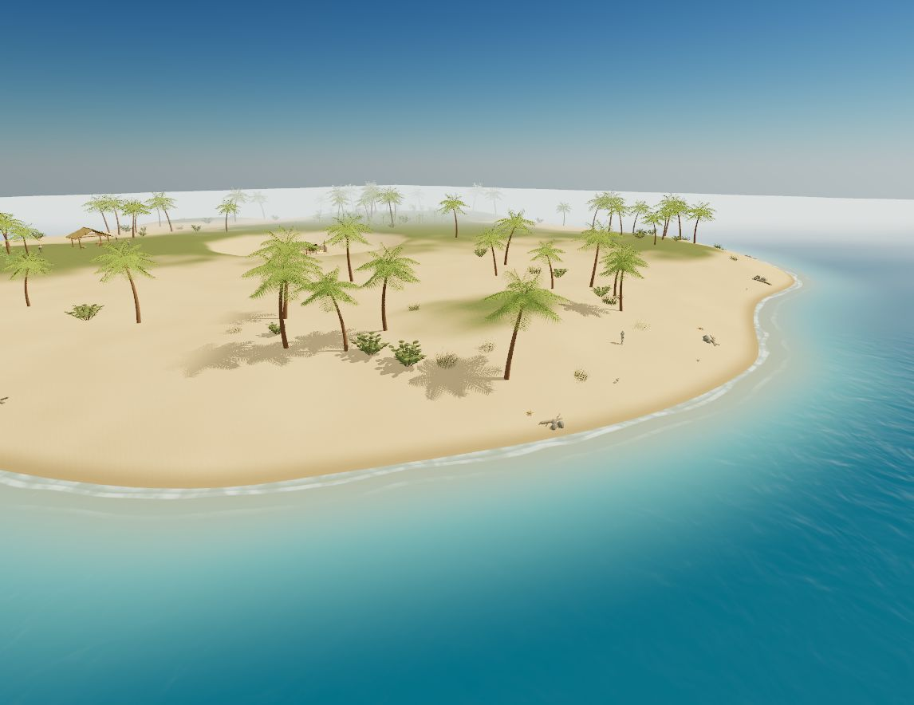
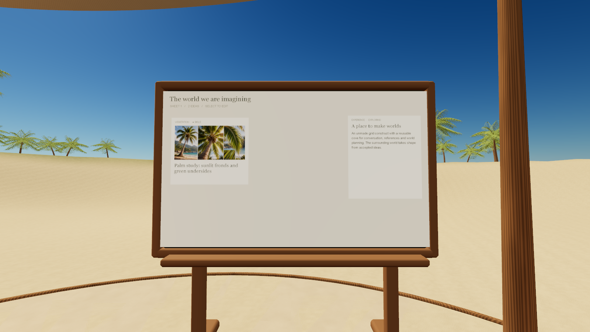

# Holodeck

A local browser workspace for creating worlds with your coding agent, powered by Kiln.

Start in a cozy cove inside the grid construct. Connect your local agent, collect references on a mood board, write a world bible, and build the world around you. Hide the cove to explore, then return to editing when you want to change something.

Holodeck is an early, actively changing prototype. It is available from source; there is no npm release.





## Start locally

You need Git, Node.js and npm. `npm ci` is the install step; launch does not download dependencies. Agent authoring uses an installed Codex CLI signed in with ChatGPT, or the Cursor CLI.

```sh
git clone https://github.com/instruktlabs/holodeck.git
cd holodeck
npm ci
node bin/holodeck.mjs launch
```

With no directory, launch uses `cove` inside `holodeck-worlds` next to your current directory, outside this checkout. A new folder receives the construct cove. An existing Holodeck world is reopened, and a folder that is not a world is left unchanged. The command starts the local server and opens `prototype.html`.

To choose the folder yourself: `node bin/holodeck.mjs launch ../my-worlds/first-world`. Then choose **Connect → Codex or Cursor**, select a model or Cursor mode, and describe what to build. Connect also configures Kiln tools in that world's workspace.

The world-name menu lets you create and switch worlds or start from **Tidemark Island**, an editable example with beaches, terrain, ocean, jungle and wildlife. Each world has its own scene, references and revision history. Your worlds live outside the source checkout, in a parent folder you choose.

See [getting started](docs/getting-started.md) for the full flow. The current checkout has been tested with Node 24.20.0 and npm 11.19.0.

## What you can do

- Build through a local Codex conversation, with model selection, approvals and cancellation.
- Edit a shared world bible and mood board with images, notes and file references.
- Review and apply scene proposals; hot-load validated Kiln assets.
- Walk, jump, swim, switch first/third-person cameras, or inspect with a free camera.
- Save, restore and remix scene revisions; create independent copies of example worlds.
- Export an accepted scene as a standalone playable static site.

## How it works

**React and React Three Fiber** drive the interface and 3D scene. Three.js renders through WebGPU with a WebGL2 fallback. The editor panels use React HTML/CSS over the viewport; the physical in-world mood board uses a canvas texture. Procedural character posing uses pmndrs math. Voice input uses local Whisper transcription through Transformers.js; model files download on first use.

A local Node host stores worlds and connects to the installed Codex app-server or the Cursor CLI through ACP. Codex works in the selected world's folder with Holodeck skills and world tools. Cursor uses the same folder, its own sign-in, and Holodeck's permission, question and plan cards. Image generation stays on Codex. **Kiln 1.3.1** supplies asset authoring and export; Holodeck owns scene composition, interaction, terrain, water, cameras and runtime activity. Kiln's root SDK stays on the Node side.

Compatible static placements use instancing and spatial chunks. Runtime behavior comes from declared built-in capabilities. The current prototype has no general physics plugin system, distance LOD or XR interface. Local agent connections are Codex and Cursor.

## Guides

- [Getting started](docs/getting-started.md) and [saved worlds](docs/world-library.md)
- [Local agent authoring](docs/local-agent-world-authoring.md)
- [World history and remixing](docs/world-history-and-export.md)
- [Static export](docs/static-export.md) and [example worlds](docs/example-worlds.md)
- [Architecture](docs/architecture.md) and [Kiln integration](docs/integration-boundary.md)
- [Coherence checks](docs/coherence-protocol.md)

## Development

```sh
npm run test:world
npm run test:runtime
npm run build
npm run check:distribution
```

Live agent inference is manual and separate from ordinary tests. Use the CLI dev command above for a selected world.

## License

**MIT for code; CC0 1.0 for our bundled assets and example worlds.** Procedural asset-generation programs are MIT. Third-party fonts and dependencies retain their own terms. Your own worlds and uploads are not automatically CC0. See [licensing and file scope](LICENSING.md) and [third-party notices](THIRD_PARTY_NOTICES.md).
