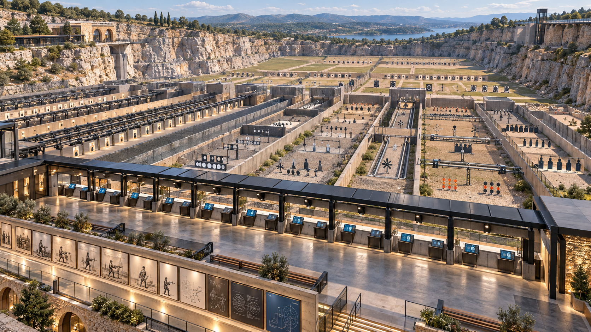

# Firearms Through Time — current reference board

## Preferred direction: shared concourse

User feedback favors this direction. Use the [style guide](STYLE-GUIDE.md) and [current blueprint](blueprints/range-campus-01.svg) together. Add stairs at both ends to a viewing deck above the booths; the concept predates this addition. Exact firearms, labels, artwork and counts remain authored work.

Concept 03 is a scale/material study with an incorrect separating-wall relationship. Concepts 01/02 and the supplied mockups below are archived exploration, superseded as layout/style authority.

## Archived exploratory board

## Current direction

A massive modern configurable range, many lanes and distinct practice activities, contemporary station interfaces, heritage stone/timber/steel architecture, and chronological artwork. The older 15-booth pack is exploratory. The first newly generated museum study is superseded because it underplayed range scale and introduced unrelated antiquities.

Built-in imagegen concept, not an approved blueprint or engine render. The second study improves scale and visible interfaces; exact lane alignment/count, interface legibility and chronological art still need authored design. No layout facts should be inferred from its pixels.

## Original supplied mockups

Supplied concept images, not implemented game screenshots. They establish architectural mood and composition; the blueprint and source-identified photographs govern layout and exhibit identity.

## Overall composition

Warm quarry enclosure, a long gallery frontage, thin dark roofs and an immediately readable transition into target activities.

## Gallery rhythm

Use the display cadence and material warmth; replace generated lettering with verified authored labels.

## Gallery and covered line

Review indoor/outdoor continuity, shaded circulation and structural consistency.

## Close detail

Use display-support and shelf composition as atmosphere references. Gun geometry is not authoritative.

## Player-height composition

Judge target readability, booth framing and view obstruction from the actual play camera.

Original source-pack images are omitted from this public branch; the generated concepts above are included.
