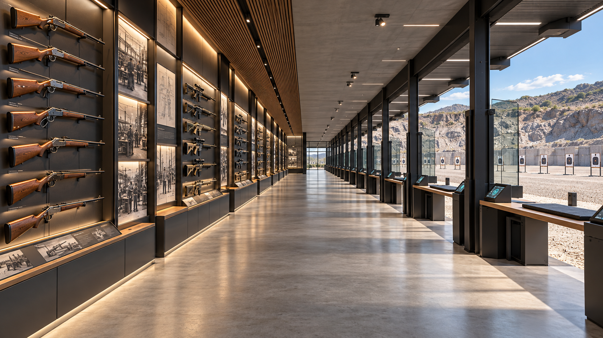

# Visual direction — modern range, chronological collection

Version 0.3 · 25 October 2026 · Working art direction, not a final approval.

## Governing reference

This is the preferred direction after user feedback: recognizable horizontally mounted firearms and historical artwork on one side, contemporary practice stations on the other, one continuous level concourse between them. Add side stairs to an upper viewing deck above the booths. The current image does not yet depict that addition.

The SVG and layout data govern placement. Concept pixels do not establish counts, dates, weapon identities, exact dimensions or walkability. The earlier overview 03 wrongly makes the display wall a separating structure; retain it only as a material/scale study, not a spatial reference. Concepts 01 and 02 and the original pack mockups are superseded for layout and gallery styling.

## Architectural language

Contemporary premium industrial architecture, with heritage expressed through limited quarry masonry, timber details and historical exhibits. Use straight structural bays, slender dark steel, pale concrete, controlled glass and clearly resolved support/contact. The collection is a firearm-history exhibition within a modern facility. Exclude classical statuary, ancient-warrior murals, armor displays, swords, pottery and temple/fortress motifs.

The range establishes breadth and depth; the collection wall establishes chronology. Neither should become an unrelated room or a separate scene. Preserve the cross-concourse relationship from player-height views.

## Material and color roles

| Role | Direction | Starting swatch |
|---|---|---|
| Main floor and structure | Pale neutral concrete, low-to-moderate sheen, subtle variation | #B8B6AE |
| Frames and exhibit backing | Matte charcoal steel, readable edge detail | #30383C |
| Joinery and display shelves | Medium natural oak, restrained warm accent | #92704E |
| Landscape enclosure | Natural desaturated quarry stone | #A99E8C |
| Interactive accents | Small teal/cyan highlights on controls, never whole walls | #55B8C5 |
| Text and labels | Warm off-white with strong local contrast | #ECEAE3 |

Swatches are art-direction values, not calibrated material measurements. Use destination rendering to tune roughness, exposure and glass. Avoid orange wash, mirror floors and excessive emissive strips.

## Collection and artwork

Mount firearms horizontally in repeatable modular bays. Give each entry an identity label, supported date/era information and a selection affordance. Chronology follows researched catalog data; do not derive historical facts from generated objects. Provide artwork between bays: historical workshop imagery, industrial/process history and exterior illustrations. No invented factual text ships from generated signage. No automatic unlocking restriction by era.

Separate original modeling references, historical artwork references and generated environment concepts. Clear rights for actual artwork and labels. Inspect full-scale cases and player-eye sightlines before approving display density.

## Interfaces and signs

Use contemporary flat panels with concise action labels, strong contrast, icons plus text, clear selected/disabled states and minimal animation. Station flow: collection/configuration → activity preset → target arrangement and game settings → preview → start → results/reset. Keep browsing accessible while an activity is idle. Do not put implementation jargon into player screens.

Wayfinding identifies bank, lane, collection chapter, stairs and return route. Color supplements text/shape. Historical labels use the same contemporary system rather than ornate period typography.

## Cameras and acceptance

- Master plan: all banks, booth row, concourse, wall and both side stair reservations.
- Concourse eye level: firearms on one side, stations/range on the other, continuous walking surface.
- Display bay: believable mounts, readable identity, artwork and selection interface.
- Booth: usable console, clear target field and configuration feedback.
- Upper deck: arrival landing, railings, connected return stairs and range overview.

Review concepts for direction, then reproduce these cameras in the actual blockout. Generated imagery does not certify engine output. The next reference pass should use blockout renders as inputs when exact geometry matters.
